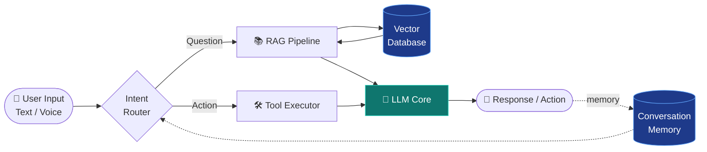
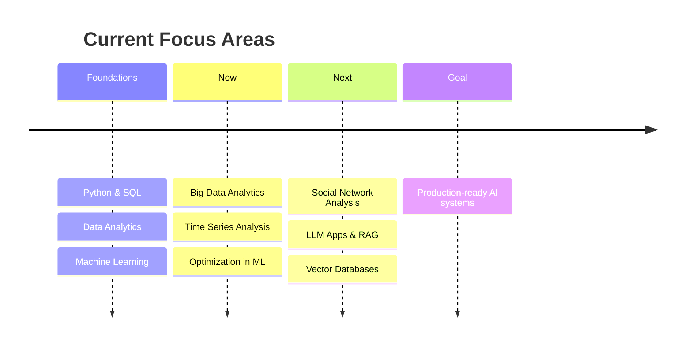

<!-- ============================================================= -->
<!--  Profile README · Vijeyendra · github.com/Nmvijeyendranath    -->
<!-- ============================================================= -->

<div align="center">


<a href="https://github.com/Nmvijeyendranath">
  
</a>

<br/>

[](https://www.linkedin.com/in/vijeyendranath)
[](mailto:vijeyendranath@gmail.com)
[](https://github.com/Nmvijeyendranath?tab=followers)


</div>

---

## 👋 Hello, I'm Vijeyendra

I'm an **Artificial Intelligence & Data Science** undergraduate at **B.M.S. College of Engineering, Bengaluru**. I enjoy the full journey from raw data to a deployed, usable AI product: cleaning and modelling data, wiring up LLM pipelines, and presenting results through clean dashboards.

```python
class Vijeyendra:
    role      = "AI & Data Science Student @ BMSCE"
    location  = "Bengaluru, India"
    focus     = ["LLM Applications", "RAG Pipelines", "Data Visualization", "Machine Learning"]
    building  = "A personal JARVIS-style AI assistant"
    learning  = ["Big Data Analytics", "Time Series Analysis",
                 "Optimization in ML", "Social Network Analysis"]
    open_to   = ["Internships", "Open-source collaboration", "AI/ML projects"]

    def say_hi(self):
        return "Let's build something intelligent."
```

---

## 🎯 Currently

| | |
|---|---|
| 🔭 **Building** | A modular JARVIS-style AI assistant with LLM reasoning, retrieval and tool use |
| 📚 **Learning** | Big Data Analytics · Time Series Analysis · Optimization in ML · Social Network Analysis · LLM application development |
| 🤝 **Collaborating on** | Data science projects, AI/ML applications, analytics dashboards, open-source |
| 🙋 **Looking for help with** | Production-grade RAG, vector databases, and real-world project development |
| 💬 **Ask me about** | Python, SQL, Data Analytics, Machine Learning, Data Visualization, AI project ideas |

---

## 🧠 Featured Project: JARVIS-Style AI Assistant

A personal assistant that combines an LLM with retrieval over my own knowledge and a set of callable tools. Here's the architecture I'm working towards:



**Highlights:** retrieval-augmented answers · tool calling · conversational memory · modular design so each component can be swapped or tested independently.

> 🔗 **Repository:** `add-your-repo-link-here`

---

## 🛠️ Tech Stack

<table>
<tr>
<td width="180"><b>🐍 Languages</b></td>
<td>


</td>
</tr>
<tr>
<td><b>🤖 AI / ML</b></td>
<td>


</td>
</tr>
<tr>
<td><b>📊 Data &amp; Visualization</b></td>
<td>


</td>
</tr>
<tr>
<td><b>⚙️ Backend &amp; Apps</b></td>
<td>


</td>
</tr>
<tr>
<td><b>🗄️ Databases</b></td>
<td>


</td>
</tr>
<tr>
<td><b>☁️ Cloud &amp; Deployment</b></td>
<td>


</td>
</tr>
<tr>
<td><b>🎨 Design</b></td>
<td>


</td>
</tr>
</table>

---

## 🗂️ Selected Projects

> Replace the rows below with your best 3 to 6 projects. Recruiters skim, so lead with the outcome.

| Project | What it does | Stack | Link |
|---|---|---|---|
| 🤖 **JARVIS Assistant** | Personal AI assistant with RAG, tool calling and memory | Python · LLMs · Vector DB · FastAPI | [Repo](https://github.com/Nmvijeyendranath) |
| 📈 **Project Name** | One line on the problem solved and the result achieved | Python · Pandas · Power BI | [Repo](https://github.com/Nmvijeyendranath) |
| 🧪 **Project Name** | One line on the problem solved and the result achieved | scikit-learn · Streamlit | [Repo](https://github.com/Nmvijeyendranath) |
| 🌐 **Project Name** | One line on the problem solved and the result achieved | Social Network Analysis · NetworkX | [Repo](https://github.com/Nmvijeyendranath) |

---

## 🧭 Learning Roadmap



---

## 📊 GitHub Analytics

<div align="center">


</div>

---

## 🤝 Let's Collaborate

I'm open to **internships, open-source contributions, and project collaborations** in:

- 🧠 AI/ML applications and LLM-powered products
- 📊 Data science projects and analytics dashboards
- 🔎 RAG systems and vector-search experiments
- 🌍 Innovative open-source ideas

<details>
<summary><b>💡 Have an AI project idea? Click here</b></summary>
<br/>

Send me a short note covering:

1. The problem you want to solve
2. The data or tools available
3. The outcome you'd like to see

I'm always happy to brainstorm, and "AI project ideas" is one of my favourite topics.

📧 **[vijeyendranath@gmail.com](mailto:vijeyendranath@gmail.com)**

</details>

<details>
<summary><b>🎲 Fun fact</b></summary>
<br/>

I love turning messy datasets into meaningful visualizations, and I'm exploring how to build my own AI assistant inspired by JARVIS.

</details>

---

<div align="center">

**⭐ If something here caught your eye, feel free to follow or drop a star. Thanks for stopping by!**


</div>
