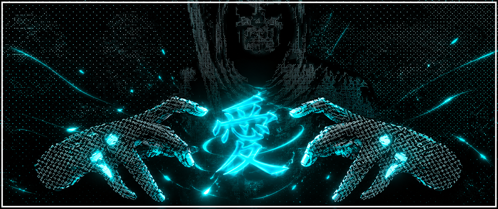

<!-- ═══════════════════════════════════════════════════════════════════════════════════
     NEURAL INTERFACE v4.2 // CYBERDECK OS // VIJEYENDRA NATH
     AI & DATA SCIENCE ARCHITECT // DEEP LEARNING × COMPUTER VISION × zkTLS
     ═══════════════════════════════════════════════════════════════════════════════════ -->

<!-- 🌌 HOLOGRAPHIC HEADER BANNER -->
<p align="center">
  
</p>

<!-- ⚡ GLITCH TERMINAL TYPING STREAM -->
<p align="center">
  <a href="https://github.com/Nmvijeyendranath">
    
  </a>
</p>

<!-- 🛡️ STATUS HUD BAR -->
<p align="center">
  <a href="#-about-me"></a>
  <a href="https://github.com/Nmvijeyendranath"></a>
  <a href="mailto:vijeyendranath@gmail.com"></a>
</p>

<p align="center">
  
</p>

<!-- ═══════════════════════════════════════════════════════════════════════════════════
     SECTION 01: ABOUT ME
     ═══════════════════════════════════════════════════════════════════════════════════ -->

<div align="center">

## 🌌 About Me

</div>

I'm **Vijeyendra Nath**, an **AI & Data Science Architect** based in **Bengaluru, India 🇮🇳**. I specialize in bridging high-dimensional deep neural architectures with zero-knowledge cryptographic infrastructure — translating complex theoretical breakthroughs into deployable, production-ready software.

- 🚀 **Building now:** Next-generation **LLM & RAG architectures**, high-dimensional vector embeddings, and real-time streaming inference systems.
- 🎯 **Flagship breakthroughs:**
  - 🛡️ **ProofPass:** Zero-knowledge credential verification protocol using **zkTLS & Groq LLaMA-3** (*Top 7 / 100+ teams in a 24-hr hackathon*).
  - 🏏 **Cricket Vision:** 323-class facial recognition system powered by **InsightFace 512-D ArcFace embeddings** and calibrated rejection (*80.58% precision, ~38ms real-time latency on RTX 3050 CUDA*).
- 🧠 **Core domains:** Deep Learning · Computer Vision · Zero-Knowledge Cryptography · High-Throughput Microservices.
- 🤝 **Open to:** High-impact AI/ML engineering roles, research collaborations, and production contracts.
- 💬 **Got a challenge?** Drop a signal below — let's build something the grid hasn't seen before.

---

<!-- ═══════════════════════════════════════════════════════════════════════════════════
     SECTION 02: LANGUAGES AND ACTIVITY (SIGNATURE RADAR DASHBOARD)
     ═══════════════════════════════════════════════════════════════════════════════════ -->

<div align="center">

## ⚡ Languages and Activity

</div>

<p align="center">
  <a href="https://github.com/Nmvijeyendranath">
    
  </a>
</p>

<p align="center">
  <sub><i>Telemetry auto-refreshed daily via GitHub Actions &amp; Python GraphQL pipeline. Hover over nodes to inspect real-time byte distributions.</i></sub>
</p>

---

<!-- ═══════════════════════════════════════════════════════════════════════════════════
     SECTION 03: MISSION ARCHIVES // FEATURED PROJECTS
     ═══════════════════════════════════════════════════════════════════════════════════ -->

<div align="center">

## 🚀 Mission Archives // Featured Projects


</div>

<br/>

<!-- MISSION 01: PROOFPASS -->
<details open>
<summary><b>🛡️ MISSION 01: PROOFPASS // ZERO-KNOWLEDGE SKILL PASSPORT</b></summary>
<br/>

<table>
<tr>
<td width="64%" valign="top">

#### `> MISSION BRIEFING`
- **Threat Assessment:** Resume fraud costs global tech employers **$3.2B annually**, while legacy verification demands complete surrender of confidential user credentials.
- **Architectural Solution:** Designed an end-to-end privacy-first verification engine where users cryptographically **prove qualifications from live authenticated sessions via zkTLS**, verified on-chain **without disclosing private credentials**.

#### `> TACTICAL PIPELINE`
```
┌─────────────┐     ┌─────────────┐     ┌─────────────┐     ┌─────────────┐
│   USER      │────▶│  zkTLS      │────▶│  GROQ AI    │────▶│  HASH       │
│   LOGIN     │     │  RECLAIM    │     │  LLAMA-3    │     │  keccak256  │
└─────────────┘     └─────────────┘     └─────────────┘     └──────┬──────┘
                                                                   │
                            ┌──────────────────────────────────────┘
                            ▼
                     ┌─────────────┐     ┌─────────────┐
                     │  EVM SMART  │────▶│  VERIFIED   │
                     │  CONTRACT   │     │  ZERO DATA  │
                     └─────────────┘     └─────────────┘
```

#### `> COMBAT STATISTICS`
- 🏆 **Top 7 / 100+ Teams** — 24-Hour Hackathon Finalist
- ⚡ **Sub-Second** On-chain verification latency
- 🔒 **100% Cryptographic Privacy** — Zero raw data leaves client device

</td>
<td width="36%" valign="top">

#### `> ARSENAL DEPLOYED`

**Frontend & Visuals:**


**Backend & Microservices:**


**Cryptography & Chain:**


**AI Acceleration:**


<br/>

<div align="center">

[](https://github.com/Nmvijeyendranath/proofpass)

</div>

</td>
</tr>
</table>

</details>

<br/>

<!-- MISSION 02: CRICKET VISION -->
<details open>
<summary><b>🏏 MISSION 02: CRICKET VISION // 323-CLASS FACIAL RECOGNITION</b></summary>
<br/>

<table>
<tr>
<td width="64%" valign="top">

#### `> MISSION BRIEFING`
- **Extreme Challenge:** Recognize any Indian cricket player across **323 separate classes** constrained by **~14 images per identity**. Conventional CNN architectures suffered catastrophic overfitting (**14.2% baseline accuracy**).
- **Breakthrough Protocol:** Deployed **512-dimensional ArcFace hyperspherical embeddings** via InsightFace buffalo_l combined with a **Sigmoid-Calibrated Linear SVM** with dynamic confidence rejection thresholds.

#### `> COMBAT METRICS`
| Metric | Performance | Operational Status |
|:---|:---:|:---:|
| **Top-1 Precision** | **71.55%** | 🟢 STABLE |
| **Top-3 Precision** | **79.71%** | 🟢 STABLE |
| **Accepted Precision** | **80.58%** | ⚡ LETHAL |
| **Inference Latency** | **~38ms / image** | 🚀 REAL-TIME (RTX 3050 CUDA) |
| **Auto-Rejection Safe-Guard** | **13.5%** | 🛡️ ACTIVE (<10% confidence rejected) |

#### `> FORENSICS & DATA HYGIENE`
Audited 7,687 images: purged 40 cross-identity label collisions, neutralized 13 corrupted buffers, eliminated 3 duplicates, and applied leakage-safe stratified evaluation splits.

</td>
<td width="36%" valign="top">

#### `> ARSENAL DEPLOYED`

**Core AI Engine:**


**Hardware & Deployment:**


<br/>

<div align="center">

[](https://github.com/Nmvijeyendranath/indian-cricket-player-recognition-system)

</div>

</td>
</tr>
</table>

</details>

<br/>

<!-- MISSION 03 & 04: PLANT DOCTOR & PORTFOLIO -->
<details>
<summary><b>🌿 MISSION 03: PLANT DOCTOR &amp; 🎨 MISSION 04: PORTFOLIO OS</b></summary>
<br/>

<table>
<tr>
<td width="50%" valign="top">

#### 🌿 PLANT DOCTOR // Leaf Pathology Diagnostic
- **Core:** Deep CNN with transfer learning identifying leaf diseases with checkpoint resumption.
- **Features:** Automated pathology report generation and real-time field diagnosis web interface.
- **Stack:** `Python` · `PyTorch` · `OpenCV` · `FastAPI`
- **Repo:** [plant-disease-detection-system](https://github.com/Nmvijeyendranath/plant-disease-detection-system)

</td>
<td width="50%" valign="top">

#### 🎨 PORTFOLIO OS // Bespoke Cyberdeck UI
- **Core:** Handcrafted digital portfolio interface with ambient animations and zero template overhead.
- **Features:** High-performance responsive layouts deployed on global edge networks.
- **Stack:** `JavaScript` · `React` · `Tailwind CSS` · `Vercel Edge`
- **Live Link:** [portfolio-app-dagb.vercel.app](https://portfolio-app-dagb.vercel.app)

</td>
</tr>
</table>

</details>

---

<!-- ═══════════════════════════════════════════════════════════════════════════════════
     SECTION 04: TACTICAL TECH STACK
     ═══════════════════════════════════════════════════════════════════════════════════ -->

<div align="center">

## 🛠️ Tactical Tech Stack


<br/>

<!-- Categorized Skill Grid -->
<table>
<tr>
<td align="center" width="25%"><b>🧠 AI / ML &amp; Vision</b></td>
<td align="center" width="25%"><b>⚡ Full-Stack &amp; Systems</b></td>
<td align="center" width="25%"><b>⛓️ Web3 &amp; Cryptography</b></td>
<td align="center" width="25%"><b>🛠️ Cloud, Data &amp; Ops</b></td>
</tr>
<tr>
<td align="center" valign="top">
  <br/>
  <sub><b>Python · PyTorch · TensorFlow</b></sub><br/>
  <sub><b>Scikit-Learn · OpenCV</b></sub>
</td>
<td align="center" valign="top">
  <br/>
  <sub><b>React · TypeScript · JavaScript</b></sub><br/>
  <sub><b>Node.js · FastAPI · Tailwind</b></sub>
</td>
<td align="center" valign="top">
  <br/>
  <sub><b>Solidity · Ethereum</b></sub><br/>
  <sub><b>zkTLS · Smart Contracts</b></sub>
</td>
<td align="center" valign="top">
  <br/>
  <sub><b>Postgres · MongoDB · Docker</b></sub><br/>
  <sub><b>AWS · Git · Linux</b></sub>
</td>
</tr>
</table>

</div>

---

<!-- ═══════════════════════════════════════════════════════════════════════════════════
     SECTION 05: CODE TELEMETRY & GITHUB ANALYTICS
     ═══════════════════════════════════════════════════════════════════════════════════ -->

<div align="center">

## 📊 Code Telemetry &amp; System Analytics

<br/>

<table align="center" border="0">
<tr>
<td align="center" valign="middle">
  
</td>
<td align="center" valign="middle">
  
</td>
</tr>
</table>

<br/>

<!-- Snake Animation -->
<picture>
  <source media="(prefers-color-scheme: dark)" srcset="https://raw.githubusercontent.com/Nmvijeyendranath/Nmvijeyendranath/output/github-contribution-grid-snake-dark.svg">
  <source media="(prefers-color-scheme: light)" srcset="https://raw.githubusercontent.com/Nmvijeyendranath/Nmvijeyendranath/output/github-contribution-grid-snake.svg">
  
</picture>

</div>

---

<!-- ═══════════════════════════════════════════════════════════════════════════════════
     SECTION 06: CONTACTS & TRANSMISSION PROTOCOL
     ═══════════════════════════════════════════════════════════════════════════════════ -->

<div align="center">

## 📡 Transmission &amp; Contacts

<p align="center">
  <a href="https://www.linkedin.com/in/vijeyendranath"></a>
  &nbsp;
  <a href="mailto:vijeyendranath@gmail.com"></a>
  &nbsp;
  <a href="https://portfolio-app-dagb.vercel.app"></a>
  &nbsp;
  <a href="https://github.com/Nmvijeyendranath"></a>
  &nbsp;
  <a href="https://discord.com"></a>
</p>

</div>

<br/>

<!-- ═══════════════════════════════════════════════════════════════════════════════════
     SECTION 07: CINEMATIC FOOTER
     ═══════════════════════════════════════════════════════════════════════════════════ -->

<p align="center">
  
</p>

<div align="center">

```
┌────────────────────────────────────────────────────────────────────────┐
│  > handshake: COMPLETE // ENCRYPTION: AES-256-GCM                      │
│  > signal: "Engineering intelligence that withstands the real world."  │
│  > status: AWAITING_YOUR_TRANSMISSION ▊▊▊                               │
└────────────────────────────────────────────────────────────────────────┘
```

<!-- Elegant Wave Transition -->


</div>

<!-- ═══════════════════════════════════════════════════════════════════════════════════
     END OF TRANSMISSION // CYBERDECK OS v4.2
     ═══════════════════════════════════════════════════════════════════════════════════ -->

